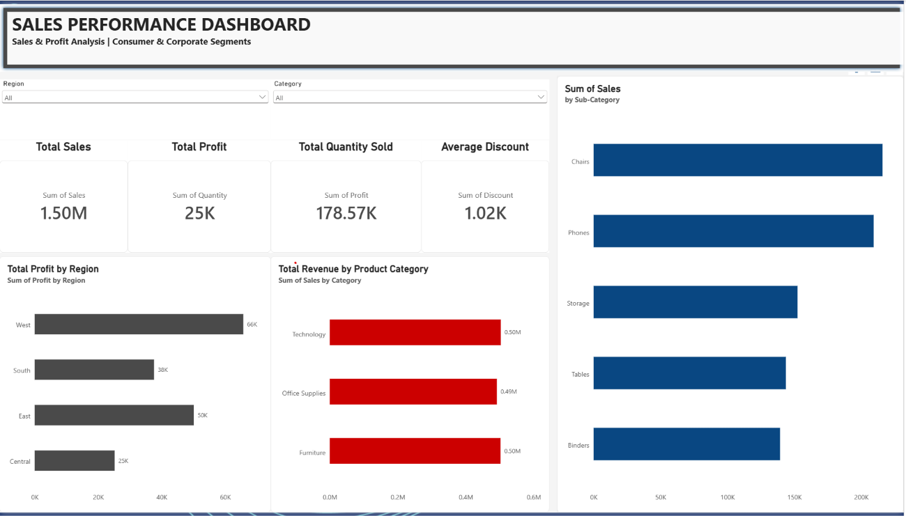

<div align="center">

# 📊 Superstore Sales Performance Dashboard

### Interactive Power BI Dashboard for Sales & Profit Analysis


</div>

---

## 📌 Table of Contents

- 🎯 [Project Overview](#-project-overview)
- ❓ [Business Problem](#-business-problem)
- 🗂️ [Dataset Description](#️-dataset-description)
- 🖼️ [Dashboard Screenshots](#️-dashboard-screenshots)
- 🎥 [Video Walkthrough](#-video-walkthrough)
- 📈 [Key KPIs](#-key-kpis)
- 🔍 [Key Insights](#-key-insights)
- 🛠️ [Tools & Technologies](#️-tools--technologies)
- ⚙️ [Project Workflow](#️-project-workflow)
- 📁 [Repository Structure](#-repository-structure)
- 🚀 [How to Use](#-how-to-use)
- 👤 [Author](#-author)

---

## 🎯 Project Overview

This project is an **interactive Power BI dashboard** built on the popular **Superstore dataset**.

It helps business users understand **sales, profit, quantity sold and discount trends** across regions, categories and sub-categories.

The report has **two pages**:

📌 **Sales Performance Dashboard** – high-level KPIs and visual summaries.

📌 **Detailed Order Information** – a drill-down table with order-level details.

---

## ❓ Business Problem

Management wants clear answers to questions like:

❔ Which **regions** generate the most profit?

❔ Which **product categories** bring the highest revenue?

❔ Which **sub-categories** sell the most?

❔ How do **discounts** affect profit?

❔ Which **customers and orders** drive the results?

This dashboard answers all of them in one place. ✅

---

## 🗂️ Dataset Description

📄 **File:** `Superstore - Dataset.csv`

📏 **Size:** ~9,994 rows × 21 columns

| 🏷️ Column | 📝 Description |
|---|---|
| Row ID | Unique row number |
| Order ID | Unique order identifier |
| Order Date / Ship Date | Date the order was placed / shipped |
| Ship Mode | Shipping method (Standard, Second Class, etc.) |
| Customer ID / Customer Name | Customer identifiers |
| Segment | Consumer, Corporate, Home Office |
| Country / City / State / Postal Code | Location details |
| Region | East, West, Central, South |
| Product ID / Product Name | Product identifiers |
| Category / Sub-Category | Product classification |
| Sales | Revenue generated |
| Quantity | Units sold |
| Discount | Discount applied |
| Profit | Profit earned |

---

## 🖼️ Dashboard Screenshots

### 📊 1. Sales Performance Dashboard

<div align="center">



</div>

**What it shows:**

✨ KPI cards for Total Sales, Total Profit, Quantity Sold and Average Discount.

✨ Profit by Region and Revenue by Product Category.

✨ Sales by Sub-Category.

✨ Slicers for **Region** and **Category** to filter the whole page.

---

### 📋 2. Detailed Order Information

<div align="center">


</div>

**What it shows:**

✨ Order-level table with Order ID, dates, ship mode, customer, segment, region, category and sub-category.

✨ Sales, Quantity, Discount and Profit for every order.

✨ Totals row for quick validation.

---

## 🎥 Video Walkthrough

▶️ **Watch the full project demo here:**

👉 [**Click to watch the video**](PASTE_YOUR_VIDEO_LINK_HERE)

> 💡 Replace `PASTE_YOUR_VIDEO_LINK_HERE` with your YouTube / Google Drive / LinkedIn video link.

---

## 📈 Key KPIs

| 💡 KPI | 📝 Meaning |
|---|---|
| 💰 **Total Sales** | Sum of all revenue |
| 📈 **Total Profit** | Sum of all profit |
| 📦 **Total Quantity Sold** | Total units sold |
| 🏷️ **Average Discount** | Discount level offered across orders |

---

## 🔍 Key Insights

🌎 **West** region delivers the highest profit, while **Central** is the lowest.

🛋️ **Technology, Furniture and Office Supplies** generate almost equal revenue.

🪑 **Chairs and Phones** are the top-selling sub-categories.

📉 Some orders with **high discounts** (e.g. 0.80) show **negative profit**, so discount strategy needs attention.

🧑‍💼 **Consumer** and **Corporate** segments are the focus of the analysis.

---

## 🛠️ Tools & Technologies

| 🧰 Tool | 🎯 Purpose |
|---|---|
| **Power BI Desktop** | Dashboard design and reporting |
| **Power Query** | Data cleaning and transformation |
| **DAX** | Measures and calculations |
| **CSV** | Source data |

---

## ⚙️ Project Workflow

1️⃣ **Import** the Superstore CSV into Power BI.

2️⃣ **Clean & transform** data using Power Query.

3️⃣ **Create** date hierarchy (Year, Quarter, Month, Day).

4️⃣ **Build measures** for Sales, Profit, Quantity and Discount.

5️⃣ **Design visuals** – KPI cards, bar charts and detail table.

6️⃣ **Add slicers** for Region and Category.

7️⃣ **Format & publish** the final dashboard.

---

## 📁 Repository Structure

```
📦 Superstore-PowerBI-Dashboard
 ┣ 📄 README.md
 ┣ 📊 Superstore.pbix
 ┣ 📄 Superstore - Dataset.csv
 ┣ 🖼️ Dashboard.png
 ┗ 🖼️ Order_Details.png
```

---

## 🚀 How to Use

1️⃣ **Clone** this repository:

```bash
git clone https://github.com/your-username/Superstore-PowerBI-Dashboard.git
```

2️⃣ **Open** `Superstore.pbix` in **Power BI Desktop**.

3️⃣ If prompted, **update the data source path** to the CSV file location.

4️⃣ Click **Refresh** and explore the dashboard using the slicers. 🎉

---

## 🌟 Future Improvements

🔹 Add monthly / yearly **trend line charts**.

🔹 Add **customer segment** and **state-wise map** visuals.

🔹 Add **profit margin %** KPI.

🔹 Publish to **Power BI Service** for sharing.

---

## 👤 Author

**Swayam Vekariya**


<div align="center">

### ⭐ If you like this project, please give it a star! ⭐

Made with ❤️ using **Power BI**

</div>
